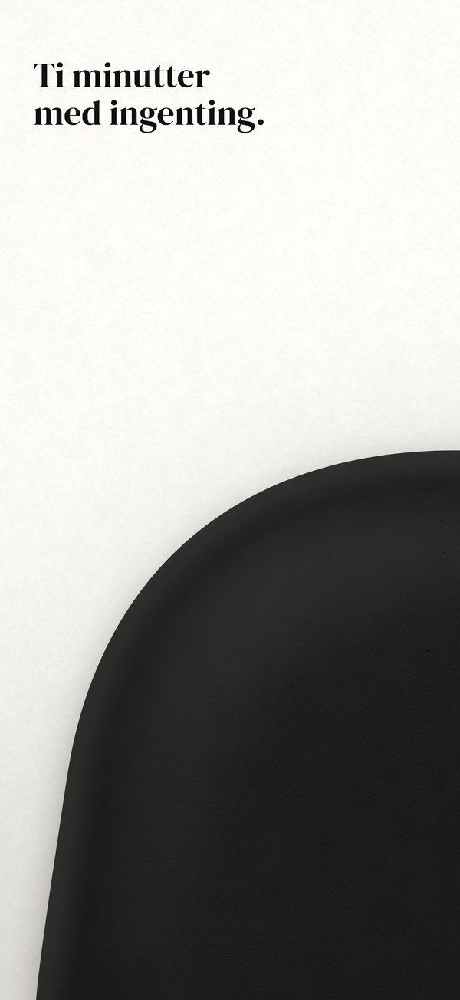
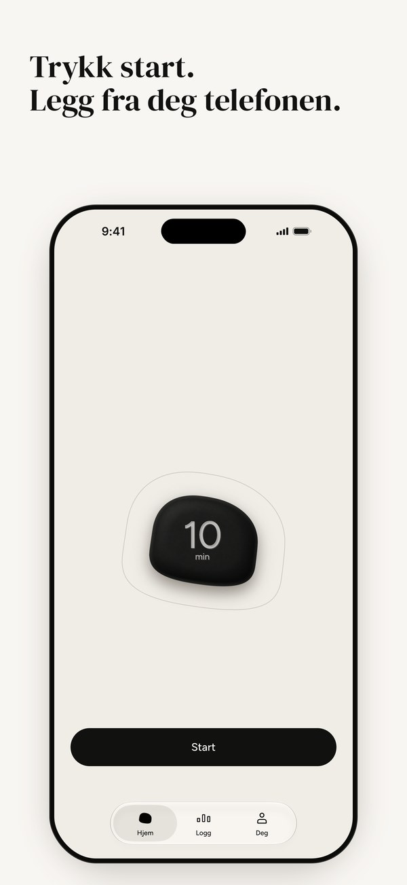
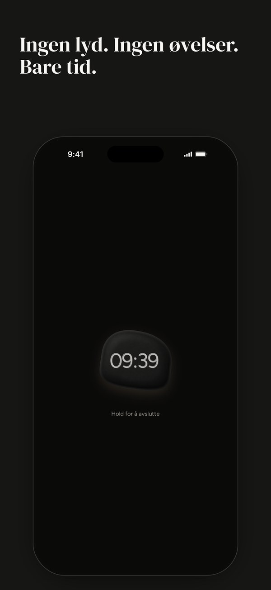
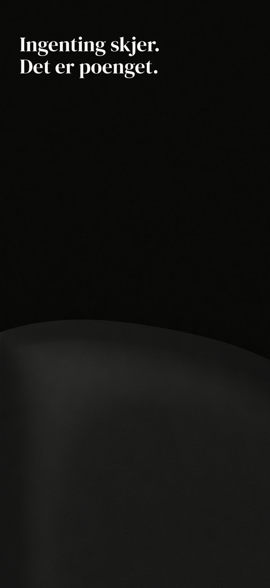
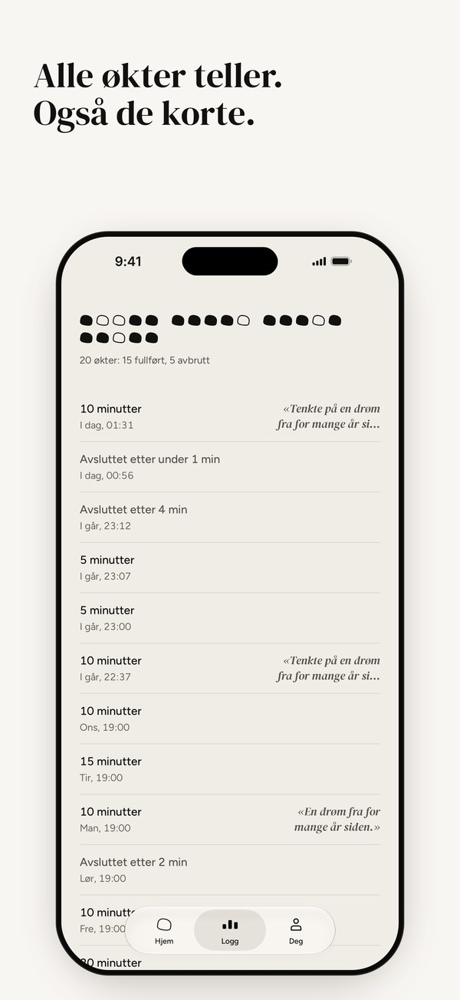
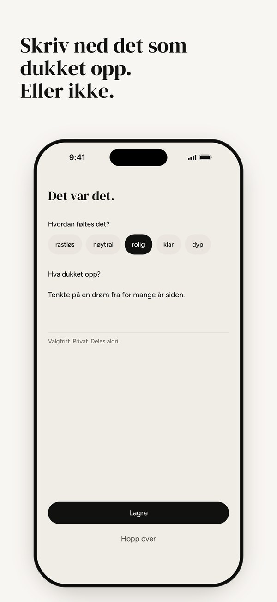
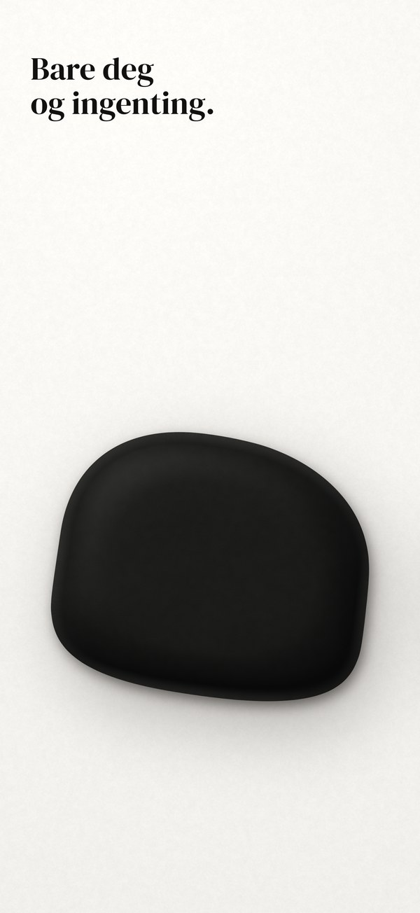

# bored.

[](https://apps.apple.com/no/app/bored/id6829862550)

**Kjed deg. Med vilje.**

Ti minutter med ingenting.

Dette er en app for å kjede seg. Med vilje. Du setter av noen minutter om dagen, legger fra deg alt annet og lar tiden gå. Ti minutter er standard, men du bestemmer selv.

Slik fungerer det

- Start en økt. Klumpen holder tiden, så du slipper å se på klokka.
- Kjed deg. Ingenting skjer. Det er poenget.
- Vil du ut, holder du inne klumpen. Da er økten over.
- Etterpå kan du skrive et kort notat om hvordan det føltes. Hvis du vil.
- Loggen viser alle øktene dine. Alle økter teller, også de korte.

Ikke meditasjon. Ingen pusteteknikker. Ingen stemme som forteller deg hva du skal føle. Bare deg og ingenting.

Kanskje blir du urolig. Kanskje dukker det opp tanker. Det er vanlig. Du trenger ikke gjøre noe med det.

Appen er bare på norsk, og ligger foreløpig bare i App Store i Norge.

<table>
  <tr>
    <td align="center"></td>
    <td align="center"></td>
    <td align="center"></td>
    <td align="center"></td>
  </tr>
  <tr>
    <td align="center"></td>
    <td align="center"></td>
    <td align="center"></td>
  </tr>
</table>

## English

bored. is an iPhone app for being bored on purpose. You set aside a few minutes each day, put everything else down, and let time pass. Ten minutes is the default, but you choose the length.

Start a session. The stone (Klumpen) keeps time, so you do not watch the clock. Nothing happens. That is the point. Hold the stone if you want to leave, and the session ends. Afterwards you can write a short note about how it felt, if you want. The log shows every session, including the short ones.

This is not meditation. No breathing exercises. No voice telling you what to feel. Just you and nothing.

You might feel restless. Thoughts might show up. That is normal. You do not have to do anything with them.

The app is in Norwegian only, and is currently available only on the App Store in Norway.

[Download on the App Store](https://apps.apple.com/no/app/bored/id6829862550)

## Teknologi

- Expo SDK 58, React Native and TypeScript
- [React Native Skia](https://shopify.github.io/react-native-skia/) for the session visuals
- Mixpanel (EU) for analytics
- EAS Build and Submit for the iOS release
- 277 tests in 55 files, run with `npm test` (Node's built-in test runner), plus `npm run typecheck`

iPhone, iOS 16.4 or later.

## Slik ble appen laget

Designet og produktledet av Dusan Jakovic, og bygget med et team av AI-agenter (Cursor cloud agents) som han orkestrerte.

Designed and product-led by Dusan Jakovic, and built with a team of AI agents (Cursor cloud agents) that he orchestrated.

## Komme i gang

```sh
npm install
npx expo start
```

Requires Node.js. Open the project in Expo Go on an iPhone, or in the iOS simulator.

## Lenker

- [App Store](https://apps.apple.com/no/app/bored/id6829862550)
- [Personvernerklæring](https://dusjak.github.io/bored-pages/personvern)
- [Support](https://dusjak.github.io/bored-pages/support)

The source is released under the [MIT License](LICENSE).
